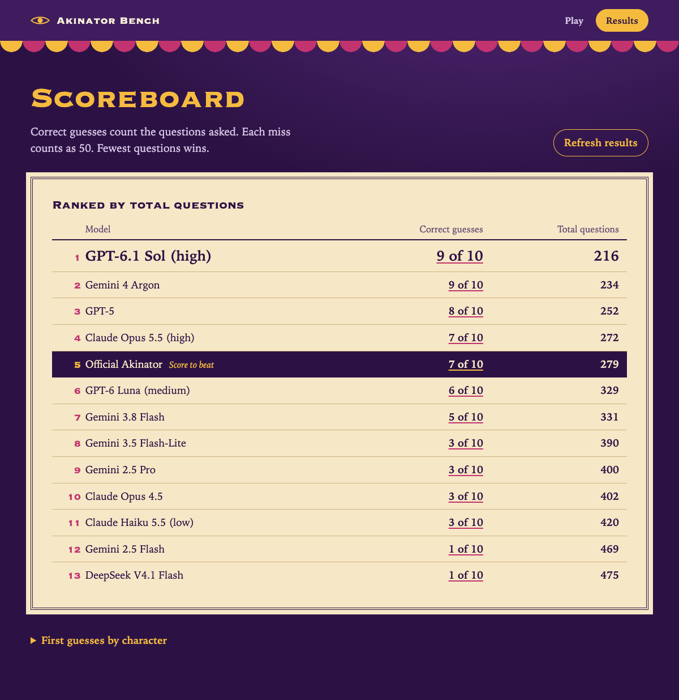
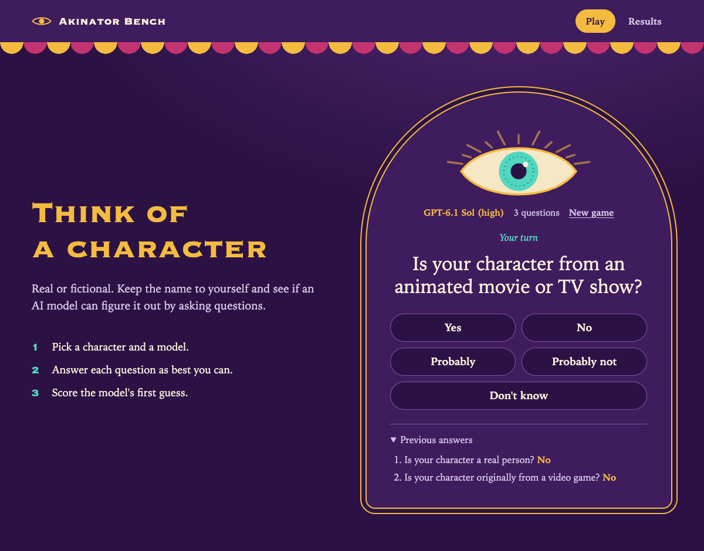

# Akinator Bench

A local guessing game and a benchmark of 12 language models across 10 targets, with the official
Akinator game as a comparison. The bundled report contains 120 model games and 10 official trials.

## View the reference scoreboard

Use Node.js 22 or later. The app uses the Node standard library.

```sh
npm start
```

Open [http://127.0.0.1:4318](http://127.0.0.1:4318) and choose **Results**. The recorded scores are
available without API access. Choose a correct-guess count, or expand **First guesses by character**, to read available game transcripts.
Set `AKINATOR_PORT` to use another port.



Ranked by total questions. Each incorrect guess counts as 50 questions.

| Rank | Model or baseline | Correct guesses | Total questions |
| ---: | --- | ---: | ---: |
| 1 | GPT-6.1 Sol (high) | 9/10 | 216 |
| 2 | Gemini 4 Argon | 9/10 | 234 |
| 3 | GPT-5 | 8/10 | 252 |
| 4 | Claude Opus 5.5 (high) | 7/10 | 272 |
| 5 | Official Akinator | 7/10 | 279 |
| 6 | GPT-6 Luna (medium) | 6/10 | 329 |
| 7 | Gemini 3.8 Flash | 5/10 | 331 |
| 8 | Gemini 3.5 Flash-Lite | 3/10 | 390 |
| 9 | Gemini 2.5 Pro | 3/10 | 400 |
| 10 | Claude Opus 4.5 | 3/10 | 402 |
| 11 | Claude Haiku 5.5 (low) | 3/10 | 420 |
| 12 | Gemini 2.5 Flash | 1/10 | 469 |
| 13 | DeepSeek V4.1 Flash | 1/10 | 475 |

## Play or run a new benchmark

Copy [.env.example](.env.example) to `.env` and supply your own values for the providers you plan
to use. The Azure base is your deployment resource's HTTPS OpenAI v1 URL ending in `/openai/v1/`.
Available model IDs and default deployment names are in [models.mjs](models.mjs). Set
`AKINATOR_<MODEL_ID_IN_UPPERCASE>_MODEL` to override a deployment name for your account.

```sh
node --env-file=.env server.mjs
```

In **Play**, pick an enabled model and think of a character. Answer its questions and judge its
first guess. Interactive play uses the selected model's provider. Batch runs also require the
providers for the answerers described in the methodology.



The gameplay screenshot replays the first three questions from the saved Pickle Rick round.

```sh
node --env-file=.env bench.mjs --model haiku --character tom_cruise
AKINATOR_RESULTS_FILE=runs/results.json node --env-file=.env server.mjs
```

Omit `--model` and `--character` to use all configured models and all ten targets. Repeat either
flag for a subset. Use `--output` to keep runs in separate files. Add `--resume` with the same
selection, settings and output to keep completed games and retry interrupted ones. Use one runner
per output file. `--concurrency` defaults to 5 and accepts 1 through 10. Local environment files
and generated runs are gitignored.

Run the checks with `npm test`. See [Methodology](METHODOLOGY.md) for the protocol, scoring and
limits of the comparison.
